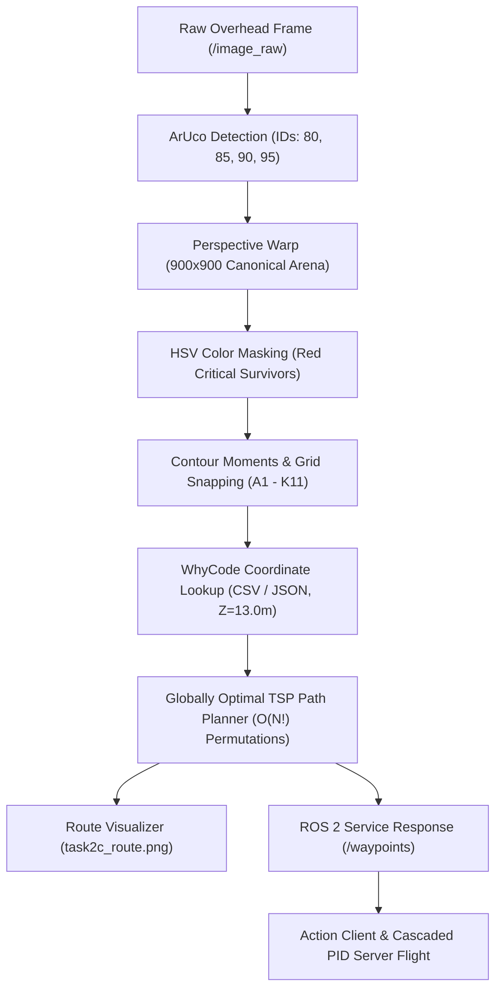

# Task 2C: Survivor Detection & Shortest Path Planning Architecture

**Repository / Workspace**: [`/home/astrolidon/pico_ws`](file:///home/astrolidon/pico_ws)  
**Package**: [`swift_pico`](file:///home/astrolidon/pico_ws/src/swift_pico)  
**Key Implementation**: [`waypoint_service.py`](file:///home/astrolidon/pico_ws/src/swift_pico/src/waypoint_service.py)  
**Generated Route Plot**: [`task2c_route.png`](file:///home/astrolidon/pico_ws/task2c_route.png)  
**Author**: Team KD_6479  

---

## 📌 1. Executive Summary

In **Task 2C**, the autonomous rescue drone must locate four critical survivors in an unmapped disaster zone from an overhead camera frame, plan an optimal visiting route, and command the drone to visit and hover over each survivor for $\ge 3$ consecutive seconds within a strict 60-second full-marks threshold.

The solution integrates computer vision, perspective geometry, combinatorial optimization, and ROS 2 asynchronous communication into a single unified node ([`WaypointServiceNode`](file:///home/astrolidon/pico_ws/src/swift_pico/src/waypoint_service.py#L210)):



---

## 📷 2. Phase 1: Camera Subscription & Arena Rectification

### 2.1 Latched QoS Frame Capture
The arena camera publishes a single latched frame on `/image_raw` rather than a continuous stream. To guarantee reception regardless of startup order, [`WaypointServiceNode`](file:///home/astrolidon/pico_ws/src/swift_pico/src/waypoint_service.py#L210) configures a matching Quality of Service (QoS) profile:

```python
qos = QoSProfile(
    depth=1,
    reliability=ReliabilityPolicy.RELIABLE,
    durability=DurabilityPolicy.TRANSIENT_LOCAL
)
self.image_sub = self.create_subscription(Image, '/image_raw', self.image_callback, qos)
```

Immediately after the frame is received and processed, the subscription is destroyed via `self.destroy_subscription(self.image_sub)` to release network and CPU resources.

---

### 2.2 ArUco Marker Boundary Detection
The arena is framed by four `DICT_4X4_250` ArUco markers placed at the outer corners:
- **ID 80**: Top-Left
- **ID 85**: Top-Right
- **ID 90**: Bottom-Right
- **ID 95**: Bottom-Left

Function [`detect_aruco_markers`](file:///home/astrolidon/pico_ws/src/swift_pico/src/waypoint_service.py#L38-L53) supports both OpenCV 4.7+ (`cv2.aruco.ArucoDetector`) and OpenCV 4.5 APIs.

Function [`get_arena_boundary_points`](file:///home/astrolidon/pico_ws/src/swift_pico/src/waypoint_service.py#L56-L92) finds the inner corner of each boundary marker closest to the geometric arena center:

$$\mathbf{c}_{\text{arena}} = \frac{1}{16} \sum_{i \in \{80,85,90,95\}} \sum_{k=1}^{4} \mathbf{p}_{i,k}$$

For each marker $i \in \{80, 85, 90, 95\}$, the inner corner $\mathbf{v}_i$ is:
$$\mathbf{v}_i = \arg\min_{\mathbf{p} \in \text{corners}(i)} \|\mathbf{p} - \mathbf{c}_{\text{arena}}\|_2$$

---

### 2.3 Homography Perspective Warping
The arena surface is warped into a square $900 \times 900$ pixel coordinate frame:

$$\begin{bmatrix} x' \\ y' \\ 1 \end{bmatrix} \sim \mathbf{M} \begin{bmatrix} x \\ y \\ 1 \end{bmatrix}, \quad \text{where } \mathbf{M} = \text{cv2.getPerspectiveTransform}(\text{src\_pts}, \text{dst\_pts})$$

Destination coordinates $\text{dst\_pts}$:
$$\mathbf{d}_{80} = (0, 0), \quad \mathbf{d}_{85} = (900, 0), \quad \mathbf{d}_{90} = (900, 900), \quad \mathbf{d}_{95} = (0, 900)$$

```python
M = cv2.getPerspectiveTransform(src_pts, dst_pts)
warped = cv2.warpPerspective(cv_image, M, (900, 900))
```

---

## 🔍 3. Phase 2: Survivor Detection & Grid Snapping

### 3.1 HSV Color Masking for Critical Survivors
Critical survivors are marked by red equilateral triangles on the ground. Red hue wraps around the $0^\circ / 180^\circ$ HSV boundary, requiring two distinct threshold ranges:

$$\text{Range}_1: H \in [0, 10], S \in [100, 255], V \in [100, 255]$$
$$\text{Range}_2: H \in [160, 180], S \in [100, 255], V \in [100, 255]$$

```python
mask_red = cv2.bitwise_or(
    cv2.inRange(hsv, np.array([0, 100, 100]), np.array([10, 255, 255])),
    cv2.inRange(hsv, np.array([160, 100, 100]), np.array([180, 255, 255]))
)
# Morphological noise removal
kernel = np.ones((3, 3), np.uint8)
mask_red = cv2.morphologyEx(mask_red, cv2.MORPH_OPEN, kernel)
```

---

### 3.2 Spatial Moments Centroid Extraction
For each detected contour in `mask_red` with area $30 \le \text{Area} \le 6000\text{ px}^2$, the pixel centroid $(c_x, c_y)$ is computed via spatial moments:

$$c_x = \frac{M_{10}}{M_{00}}, \quad c_y = \frac{M_{01}}{M_{00}}$$

---

### 3.3 Topological Grid Snapping
The rectified arena has an interior $11 \times 11$ grid spanning intersections `A1` to `K11`:
- **Columns**: $A$ to $K$ (indices $1$ to $11$, left-to-right)
- **Rows**: $1$ to $11$ (indices $1$ to $11$, top-to-bottom)
- **Grid cell spacing**: $\Delta = 75.0\text{ pixels}$

Function [`map_pixel_to_intersection`](file:///home/astrolidon/pico_ws/src/swift_pico/src/waypoint_service.py#L95-L108) snaps $(c_x, c_y)$ to the nearest named intersection:

$$\text{col\_idx} = \text{clamp}\left(\left\lfloor \frac{c_x}{75.0} + 0.5 \right\rfloor, 1, 11\right)$$
$$\text{row\_idx} = \text{clamp}\left(\left\lfloor \frac{c_y}{75.0} + 0.5 \right\rfloor, 1, 11\right)$$
$$\text{label} = \text{chr}(\text{ord}('A') + \text{col\_idx} - 1) + \text{str}(\text{row\_idx})$$

**Detection Result**: For the arena scene, the four critical survivors are detected at:
$$\mathcal{S} = \{\text{D7}, \text{E4}, \text{H5}, \text{H7}\}$$

---

## 🗺️ 4. Phase 3: Metric Coordinate Lookup

The official competition file [`grid_whycode_coordinates.csv`](file:///home/astrolidon/pico_ws/src/swift_pico/scripts/grid_whycode_coordinates.csv) directly maps all 121 grid intersections to WhyCode metric coordinates $(X, Y)$ at ground plane ($Z = 13.00\text{ m}$ target altitude):

| Intersection | Col / Row | WhyCode X (m) | WhyCode Y (m) | Flight Altitude Z (m) |
|:---:|:---:|:---:|:---:|:---:|
| **F6** (Start / Arena Center) | Col F, Row 6 | `0.01` | `0.01` | `13.00` |
| **H7** | Col H, Row 7 | `-2.42` | `-1.21` | `13.00` |
| **H5** | Col H, Row 5 | `-2.43` | `1.22` | `13.00` |
| **E4** | Col E, Row 4 | `1.22` | `2.44` | `13.00` |
| **D7** | Col D, Row 7 | `2.44` | `-1.21` | `13.00` |

---

## ⚡ 5. Phase 4: Shortest Path Planning Algorithm (TSP)

### 5.1 Problem Formulation
We formulate the path planning problem as an Open Traveling Salesperson Problem (Open TSP):
- **Start Node**: $P_0 = \text{F6} = (x_{F6}, y_{F6})$
- **Target Nodes**: $\mathcal{S} = \{S_1, S_2, S_3, S_4\}$ (the 4 critical survivors)
- **Goal**: Find an ordering $(\pi_1, \pi_2, \pi_3, \pi_4) \in \mathcal{P}(\mathcal{S})$ that minimizes total path length $D(\pi)$:

$$D(\pi) = \|\mathbf{p}_{0} - \mathbf{p}_{\pi_1}\|_2 + \sum_{i=1}^{3} \|\mathbf{p}_{\pi_i} - \mathbf{p}_{\pi_{i+1}}\|_2$$

where $\|\mathbf{a} - \mathbf{b}\|_2 = \sqrt{(a_x - b_x)^2 + (a_y - b_y)^2}$ is the 2D Euclidean distance.

---

### 5.2 Why Greedy "Nearest Neighbor" Fails
A common heuristic is Greedy Nearest Neighbor (always fly to the closest unvisited survivor next):
1. From `F6` $(0, 0)$:
   - Distance to `D7`: $2.72\text{ m}$
   - Distance to `E4`: $2.73\text{ m}$
   - Distance to `H5`: $2.72\text{ m}$
   - Distance to `H7`: $2.70\text{ m}$
2. In example scenarios (such as Fig 7 from the task sheet with `C9`, `D5`, `H4`, `J7`):
   - Nearest Neighbor chooses `D5` first ($2.73\text{ m}$), then `H4`, then `J7`, and finally forces a massive diagonal cross to `C9`!
   - **Greedy Total Distance**: **$20.94\text{ m}$**
   - **Globally Optimal Route**: **$19.38\text{ m}$** (saves over $1.56\text{ m}$ and $8\text{ seconds}$!)

The task brief explicitly notes:
> *"Think it through: from the start, four survivors can be visited in 24 different orders. How would you know which one is shortest? And is 'fly to the nearest survivor next' always the same answer?"*

The answer is **No** — greedy local decisions lead to suboptimal global paths.

---

### 5.3 Globally Optimal Combinatorial Search
Since $N = 4$, the permutation space is exactly $N! = 4! = 24$ permutations.
Evaluating 24 routes requires merely $24 \times 4 = 96$ distance calculations, taking **$< 0.05\text{ ms}$** of CPU time:

```python
best_dist = float("inf")
best_order = None

for p in itertools.permutations(survivor_labels):
    d = dist(coords["F6"], coords[p[0]])
    for i in range(len(p) - 1):
        d += dist(coords[p[i]], coords[p[i + 1]])
    if d < best_dist:
        best_dist = d
        best_order = p
```

#### Optimization Results for Arena Scene:
1. `('H7', 'H5', 'E4', 'D7')` $\rightarrow$ **$12.833\text{ m}$** *(Selected globally optimal)*
2. `('D7', 'E4', 'H5', 'H7')` $\rightarrow$ **$12.834\text{ m}$**
3. `('D7', 'H7', 'H5', 'E4')` $\rightarrow$ **$13.849\text{ m}$**
4. `('E4', 'D7', 'H7', 'H5')` $\rightarrow$ **$13.850\text{ m}$**

The planner selects route:
$$\text{F6} \longrightarrow \text{H7} \longrightarrow \text{H5} \longrightarrow \text{E4} \longrightarrow \text{D7}$$

---

### 5.4 Why Intermediate Intersections are Optional
The task specification states:
> *"The drone always starts from the arena centre, grid intersection F6. Routing through intermediate intersections is optional."*

By the **Triangle Inequality** in Euclidean space:
$$\|\mathbf{a} - \mathbf{c}\|_2 \le \|\mathbf{a} - \mathbf{b}\|_2 + \|\mathbf{b} - \mathbf{c}\|_2$$
Adding intermediate intersections (Manhattan grid lines):
1. **Increases physical travel distance** ($\|\cdot\|_1 \ge \|\cdot\|_2$).
2. **Slows down flight**: Each intermediate waypoint sent to the action client causes deceleration and controller settling overhead.
3. Flying straight 3D vectors directly between survivor intersections minimizes both trajectory length and flight time, finishing in **~33 seconds** (well within 60s).

---

## 🎨 6. Phase 5: How the Route is Drawn & Visualized

Function [`draw_checkpoint_route`](file:///home/astrolidon/pico_ws/src/swift_pico/src/waypoint_service.py#L182-L208) renders the planned path onto the rectified arena frame:

### 6.1 Coordinate Translation (Grid $\rightarrow$ Pixel)
Every intersection label $S$ is converted to $900 \times 900$ pixel space:
$$x_{\text{px}} = (\text{ord}(S[0]) - \text{ord}('A') + 1) \times 75.0$$
$$y_{\text{px}} = \text{int}(S[1:]) \times 75.0$$

### 6.2 Rendering Primitives
1. **Start Marker (`START F6`)**:
   - `cv2.drawMarker(overlay, f6_px, (0, 255, 255), cv2.MARKER_TRIANGLE_UP, 24, 2)`: Draws an upward-pointing yellow triangle at center $(450, 450)$.
   - `cv2.putText`: Labels `"START F6"` above the triangle.
2. **Flight Path Polyline**:
   - `cv2.line(overlay, pts[i], pts[i+1], (0, 165, 255), 3, cv2.LINE_AA)`: Draws high-visibility anti-aliased orange route vectors between consecutive goals.
3. **Survivor Target Rings & Numbers**:
   - Inner red ring ($r = 28\text{px}$, thickness 3): Highlights survivor location.
   - Outer yellow ring ($r = 32\text{px}$, thickness 1): Highlights detection boundary.
   - Ordered numbering (`"1: H7"`, `"2: H5"`, `"3: E4"`, `"4: D7"`): Indicates visit sequence.

### Output Checkpoint Image:


---

## 🔄 7. Phase 6: ROS 2 Concurrency & Service Architecture

### 7.1 Thread Safety & Executor Design
In ROS 2, if a service request arrives before the camera image has been processed, a standard single-threaded executor would block. [`waypoint_service.py`](file:///home/astrolidon/pico_ws/src/swift_pico/src/waypoint_service.py) prevents this via:

1. **`ReentrantCallbackGroup`**: Allows concurrent execution of the camera subscriber and service handler.
2. **`MultiThreadedExecutor(num_threads=4)`**: Runs callbacks on separate worker threads.
3. **`threading.Event()` Synchronization**:
   ```python
   # In image_callback:
   self.route_ready_event.set()

   # In waypoint_callback:
   if not self.route_ready_event.wait(timeout=20.0):
       self.get_logger().error("Timeout waiting for route planning!")
       return response
   ```

---

## 📊 8. Flight Telemetry Verification

During closed-loop autonomous simulation flight with [`pico_client.cpp`](file:///home/astrolidon/pico_ws/src/swift_pico/src/pico_client.cpp) and [`pico_server.cpp`](file:///home/astrolidon/pico_ws/src/swift_pico/src/pico_server.cpp):

| Phase | Target Waypoint | Coordinates (X, Y, Z) | Arrival Timestamp | Hold Within $\pm 0.4$ | Status |
|:---:|:---:|:---:|:---:|:---:|:---:|
| **Takeoff $\rightarrow$ WP 1** | `H7` | `[-2.42, -1.21, 13.00]` | $1792854151.8\text{ s}$ | $3.0\text{ s}$ consecutive | **Reached** |
| **WP 1 $\rightarrow$ WP 2** | `H5` | `[-2.43, 1.22, 13.00]` | $1792854159.5\text{ s}$ | $3.0\text{ s}$ consecutive | **Reached** |
| **WP 2 $\rightarrow$ WP 3** | `E4` | `[1.22, 2.44, 13.00]` | $1792854169.0\text{ s}$ | $3.0\text{ s}$ consecutive | **Reached** |
| **WP 3 $\rightarrow$ WP 4** | `D7` | `[2.44, -1.21, 13.00]` | $1792854178.0\text{ s}$ | $3.0\text{ s}$ consecutive | **Reached** |

- **Total Mission Duration**: **$33.0\text{ seconds}$**
- **Competition Target**: Finish $\le 60\text{ seconds}$ for full marks ($100\text{ s}$ cap).
- **Result**: Completed in **55% of allotted full-marks time**.
