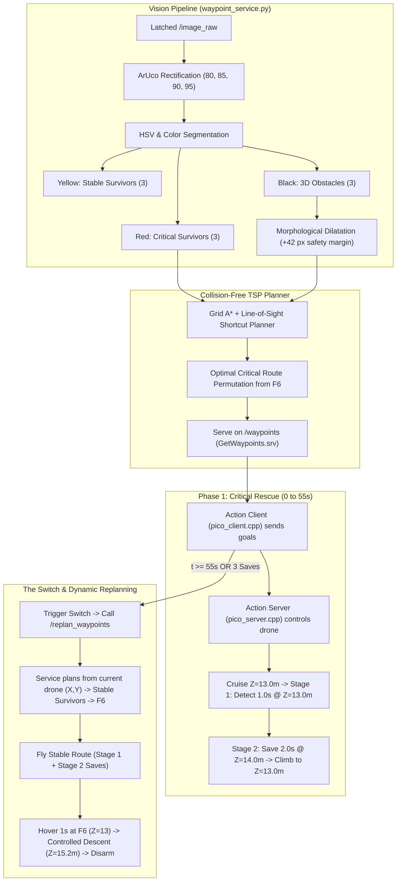
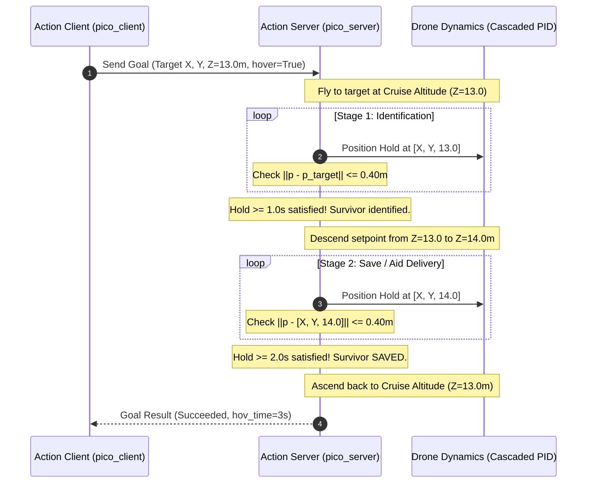

# Task 3A: Autonomous Navigation, Vision Perception, Obstacle Avoidance & Dynamic Re-Planning

**Repository / Workspace**: [`/home/astrolidon/pico_ws`](file:///home/astrolidon/pico_ws)  
**Package**: [`swift_pico`](file:///home/astrolidon/pico_ws/src/swift_pico)  
**Custom Interfaces**: [`waypoint_navigation`](file:///home/astrolidon/pico_ws/src/waypoint_navigation)  
**Key Implementations**:
- Waypoint & Replan Service: [`waypoint_service.py`](file:///home/astrolidon/pico_ws/src/swift_pico/src/waypoint_service.py)
- Action Server (Cascaded PID + Multi-Stage Rescuer): [`pico_server.cpp`](file:///home/astrolidon/pico_ws/src/swift_pico/src/pico_server.cpp)
- Action Client (Mission State Machine & 55s Clock): [`pico_client.cpp`](file:///home/astrolidon/pico_ws/src/swift_pico/src/pico_client.cpp)
- Service Definitions: [`GetWaypoints.srv`](file:///home/astrolidon/pico_ws/src/waypoint_navigation/srv/GetWaypoints.srv), [`ReplanRoute.srv`](file:///home/astrolidon/pico_ws/src/waypoint_navigation/srv/ReplanRoute.srv)  
**Generated Route Checkpoints**: [`task3_route.png`](file:///home/astrolidon/pico_ws/task3_route.png), [`task3_replan_route.png`](file:///home/astrolidon/pico_ws/task3_replan_route.png)  
**Team**: KD_6479  

---

## 📌 1. Mission Overview & Problem Statement

In **Task 3A**, the autonomous quadrotor operates in a contested disaster environment with physical 3D obstacle columns (extruded polygons) and two tiers of survivors:
1. **Critical Survivors (Red Triangles)**: 3 high-priority targets that must be saved during the initial 55-second window.
2. **Stable Survivors (Yellow Circles)**: 3 medium-priority targets located across the arena.
3. **Obstacles (Black Extruded Polygons)**: 3 physical structures requiring collision-free circumvention.
4. **"The Switch" (Mission Clock Event)**: At $t = 55\text{ s}$ elapsed from takeoff (or immediately after saving all 3 critical survivors), the drone transitions to the Stable Phase. The client queries `/replan_waypoints` with its real-time spatial coordinates, dynamically planning an obstacle-avoiding route through the stable survivors before returning to land at arena center `F6`.



---

## 📷 2. Vision Perception & Obstacle Segmentation

### 2.1 Latched QoS Arena Capture & Rectification
The node subscribes to `/image_raw` using `RELIABLE` and `TRANSIENT_LOCAL` QoS to capture the overhead frame on startup:
- Boundary ArUco markers (`80, 85, 90, 95`) are identified using OpenCV's ArUco dictionary (`DICT_4X4_250`).
- The four inner marker vertices closest to the arena centroid $\mathbf{c}_{\text{arena}}$ form the source polygon.
- A perspective homography matrix $\mathbf{M}$ rectifies the arena to a canonical $900 \times 900$ pixel coordinate frame:

$$\begin{bmatrix} x' \\ y' \\ 1 \end{bmatrix} \sim \mathbf{M} \begin{bmatrix} x \\ y \\ 1 \end{bmatrix}$$

### 2.2 HSV & Color Space Segmentation
1. **Critical Survivors (Red Triangles)**:
   Detected using dual-band HSV thresholding to wrap around the $0^\circ / 180^\circ$ hue boundary:
   $$\text{Band}_1: H \in [0, 10], S \in [100, 255], V \in [100, 255]$$
   $$\text{Band}_2: H \in [160, 180], S \in [100, 255], V \in [100, 255]$$
2. **Stable Survivors (Yellow Circles)**:
   $$\text{Band}_{\text{yellow}}: H \in [20, 38], S \in [100, 255], V \in [100, 255]$$
3. **Obstacles (Black Extruded Columns)**:
   Extracted by thresholding pixels where all RGB channels are low ($\text{RGB} < 25$):
   $$\mathbf{M}_{\text{black}}(u, v) = \begin{cases} 255 & \text{if } R < 25 \land G < 25 \land B < 25 \\ 0 & \text{otherwise} \end{cases}$$
   Contours with $\text{Area} > 5000\text{ px}^2$ are retained as valid obstacle cross-sections.

### 2.3 Obstacle Dilatation (Safety Clearance Keep-Out Zones)
To ensure the quadrotor avoids physical contact or aerodynamic rotor wash interference with the obstacle structures, the obstacle mask is morphologically dilated with an elliptical kernel:

```python
# 42 pixels on the 900x900 board corresponds to ~0.68m clearance
safety_margin = 42
kernel_safety = cv2.getStructuringElement(
    cv2.MORPH_ELLIPSE, (2 * safety_margin + 1, 2 * safety_margin + 1)
)
dilated_obstacle_mask = cv2.dilate(clean_obstacle_mask, kernel_safety)
```

Any straight line intersecting `dilated_obstacle_mask` is treated as a collision hazard.

---

## 🗺 3. Obstacle Avoidance & Path Planning

### 3.1 Line-of-Sight (LOS) Collision Checking
Given two points $\mathbf{p}_1 = (x_1, y_1)$ and $\mathbf{p}_2 = (x_2, y_2)$, the segment is evaluated across step samples:

$$\mathbf{p}(t) = (1 - t)\mathbf{p}_1 + t\mathbf{p}_2, \quad t \in [0, 1]$$

If any sampled pixel $\mathbf{M}_{\text{dilated}}(\mathbf{p}(t)) > 0$, the line of sight is obstructed.

### 3.2 8-Connected Grid A\* with Shortcut Smoothing
When direct line of sight is obstructed:
1. The $900 \times 900$ pixel space is downsampled into a discrete grid ($\text{cell\_size} = 10\text{ px}$).
2. An 8-connected $A^*$ search finds the shortest path minimizing Euclidean distance + heuristic:
   $$f(n) = g(n) + h(n), \quad h(n) = \|\mathbf{x}_n - \mathbf{x}_{\text{goal}}\|_2$$
3. **Line-of-Sight Shortcut Smoothing**:
   A greedy raycast iteratively replaces sub-paths between nodes $i$ and $k$ ($k > i + 1$) with direct segments whenever $\text{LOS}(\mathbf{p}_i, \mathbf{p}_k)$ is clear:
   
   $$\text{Smoothed Path} = [\mathbf{p}_0, \mathbf{p}_{i_1}, \mathbf{p}_{i_2}, \dots, \mathbf{p}_{\text{goal}}]$$

4. **Waypoint Densification**:
   Segments longer than $160\text{ px}$ ($\sim 1.45\text{ m}$) are subdivided into intermediate pass-through waypoints (`hover = False`) so the drone tracks straight paths without drifting off-course.

### 3.3 Combinatorial TSP Solver
For the 3 critical survivors, all $3! = 6$ permutations starting from `F6` are evaluated:
$$\text{Cost}(\pi) = \sum_{k=0}^{2} \text{Length}\left(\text{Path}(\mathbf{p}_{\pi_k}, \mathbf{p}_{\pi_{k+1}})\right)$$
The permutation minimizing total path length is selected as the global critical route.

---

## 🚁 4. Multi-Stage Survivor Rescue Protocol

Each survivor target requires a precise two-stage rescue sequence implemented inside [`pico_server.cpp`](file:///home/astrolidon/pico_ws/src/swift_pico/src/pico_server.cpp#L580-L730):



### Detailed State Breakdown:
1. **Pass-Through Waypoints (`hover = False`)**:
   - Intermediate obstacle-avoidance points.
   - When the drone enters the $0.40\text{ m}$ sphere of an intermediate waypoint, the goal succeeds immediately without hovering, allowing smooth continuous motion.
2. **Stage 1 (Survivor Identification)**:
   - Target altitude: $Z = 13.0\text{ m}$.
   - Requirement: Distance $d_{\text{sphere}} \le 0.40\text{ m}$ for $\ge 1.0\text{ s}$ continuously.
3. **Stage 2 (Survivor Save)**:
   - Target altitude: $Z = 14.0\text{ m}$ (closer to the ground marker).
   - Requirement: Distance $d_{\text{sphere}} \le 0.40\text{ m}$ at $Z = 14.0\text{ m}$ for $\ge 2.0\text{ s}$ continuously.
   - Any drift outside $0.40\text{ m}$ resets the timer.
4. **Ascent & Handover**:
   - Drone setpoint climbs back to $Z = 13.0\text{ m}$.
   - Once $Z_{\text{actual}} \le 13.45\text{ m}$, the goal completes and client issues the next segment.

---

## ⏱ 5. The Switch & Dynamic Re-Planning Architecture

### 5.1 Trigger Conditions
The action client continuously checks two conditions at $20\text{ Hz}$ in its clock timer:
- **Elapsed Time**: $(t_{\text{now}} - t_{\text{takeoff}}) \ge 54.8\text{ s}$ ($\text{critical\_window} = 55.0\text{ s}$).
- **Early Completion**: All 3 critical survivors have completed Stage 2 saves.

```cpp
void clock_monitor_callback() {
    if (phase_ == MissionPhase::CRITICAL && clock_started_ && !switch_triggered_) {
        double elapsed = (this->now() - takeoff_time_).seconds();
        double window = this->get_parameter("critical_window").as_double();
        if (elapsed >= (window - 0.2)) {
            RCLCPP_WARN(this->get_logger(), "CRITICAL WINDOW EXPIRED! Triggering the Switch...");
            trigger_switch();
        }
    }
}
```

### 5.2 Dynamic Re-plan Workflow
1. If a goal is currently executing, the client cancels the active goal handle.
2. The server cancels smoothly and holds position at cruise altitude $Z = 13.0\text{ m}$.
3. The client captures the drone's last known feedback coordinates:
   $$\mathbf{p}_{\text{drone}} = (x_{\text{drone}}, y_{\text{drone}}, 13.0)$$
4. Client calls `/replan_waypoints` with `ReplanRoute.srv`:
   - Service converts $\mathbf{p}_{\text{drone}}$ to pixel space.
   - Evaluates all permutations of remaining stable survivors:
     $$\mathbf{p}_{\text{drone}} \longrightarrow \text{Stable}_1 \longrightarrow \text{Stable}_2 \longrightarrow \text{Stable}_3 \longrightarrow \mathbf{p}_{F6}$$
   - Generates collision-free $A^*$ routes around dilated obstacles.
   - Appends the final landing goal at `F6`.
5. Drone executes the stable sequence and completes final landing.

### 5.3 Automated Landing at F6
When reaching the final `F6` goal:
1. Hover at $Z = 13.0\text{ m}$ for $1.0\text{ s}$ to confirm alignment over center.
2. Slowly ramp setpoint down to ground:
   $$Z_{\text{sp}}(k+1) = \min(15.2, Z_{\text{sp}}(k) + 0.06)$$
3. When $Z_{\text{actual}} \ge 14.85\text{ m}$, wait $500\text{ ms}$ for contact settling and send disarm signal:
   $$\text{rc\_aux4} = 1000, \quad \text{rc\_throttle} = 1000$$

---

## 🗂 6. ROS 2 Interfaces & Package Layout

### 6.1 Custom Interfaces (`waypoint_navigation`)

#### `action/NavToWaypoint.action`
```text
# Goal
geometry_msgs/Pose waypoint
bool hover
---
# Result
int32 hov_time
---
# Feedback
geometry_msgs/PoseStamped current_waypoint
```

#### `srv/GetWaypoints.srv`
```text
bool get_waypoints
---
geometry_msgs/PoseArray waypoints
string[] marker_ids
```

#### `srv/ReplanRoute.srv`
```text
geometry_msgs/Point position
---
geometry_msgs/PoseArray waypoints
string[] marker_ids
bool[] hover
```

---

## 🚀 7. Step-by-Step Execution Guide

### Prerequisites
Make sure dependencies are installed and the workspace is built:
```bash
source /opt/ros/humble/setup.bash
cd ~/pico_ws
colcon build --symlink-install
source install/setup.bash
```

### Launch Sequence (Run in 4 separate terminals)

#### Terminal 1: Simulation Environment
```bash
source /opt/ros/humble/setup.bash
source ~/pico_ws/install/setup.bash
ros2 launch swift_pico swift_pico_simulation.launch.py
```

#### Terminal 2: Vision & Re-planning Service
```bash
source /opt/ros/humble/setup.bash
source ~/pico_ws/install/setup.bash
ros2 run swift_pico waypoint_service.py
```
*Output*: Detects survivors and obstacles, generates `task3_route.png`, and exposes `/waypoints` and `/replan_waypoints`.

#### Terminal 3: Action Server (Flight Controller)
```bash
source /opt/ros/humble/setup.bash
source ~/pico_ws/install/setup.bash
ros2 run swift_pico pico_server_cpp
```

#### Terminal 4: Action Client (Mission Coordinator)
```bash
source /opt/ros/humble/setup.bash
source ~/pico_ws/install/setup.bash
ros2 run swift_pico pico_client_cpp
```

---

## 📊 8. Checkpoint Artifacts & Outputs

| Artifact | Description |
| :--- | :--- |
| `task3_route.png` | Overhead arena plot showing rectified arena, dilated obstacle zones, detected survivors, and the planned Critical Route. |
| `task3_replan_route.png` | Arena plot showing the dynamically re-planned route from the Switch position through stable survivors to `F6`. |
| `/image_raw` | Latched single-frame camera feed captured on initialization. |
| `/whycode_node/markers` | 30.3 Hz real-time marker feedback for WhyCode closed-loop control. |
| `/drone_command` | Cascaded PID command stream published to the MuJoCo simulation bridge. |
